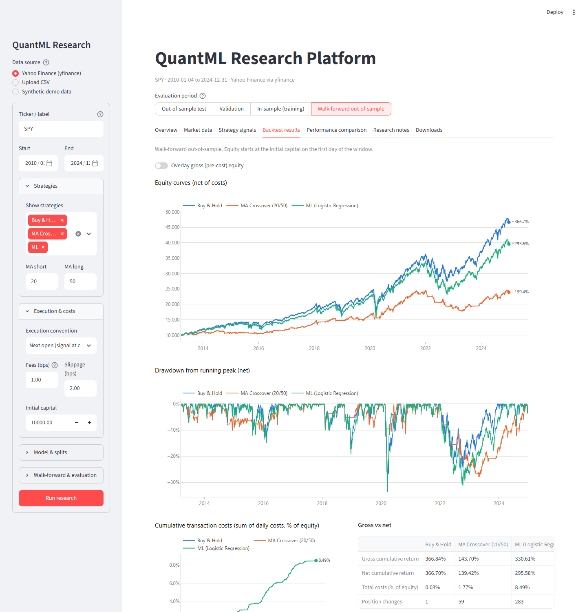
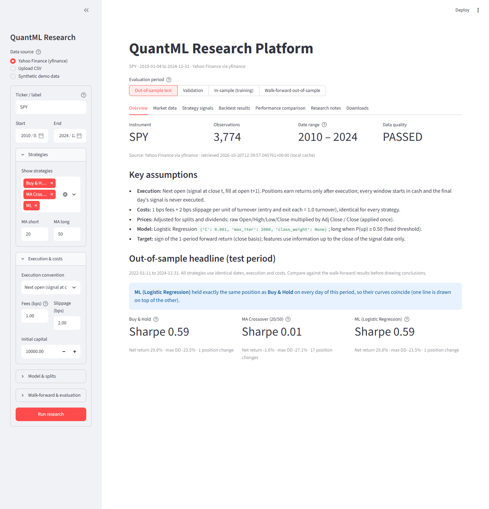
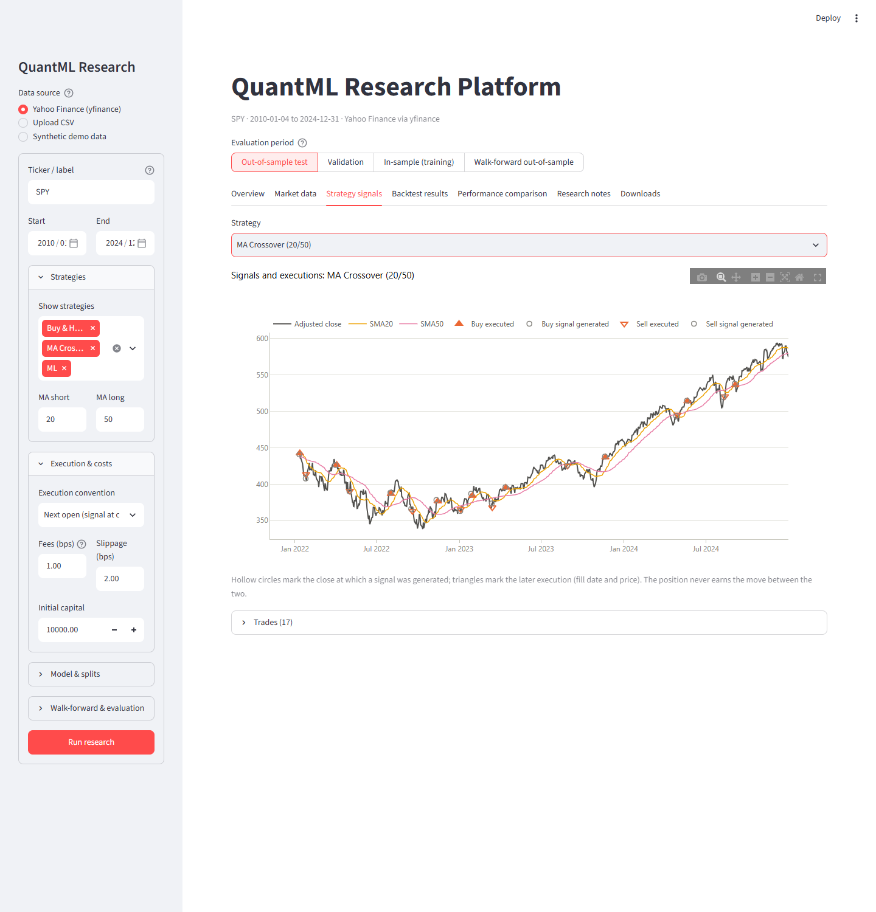
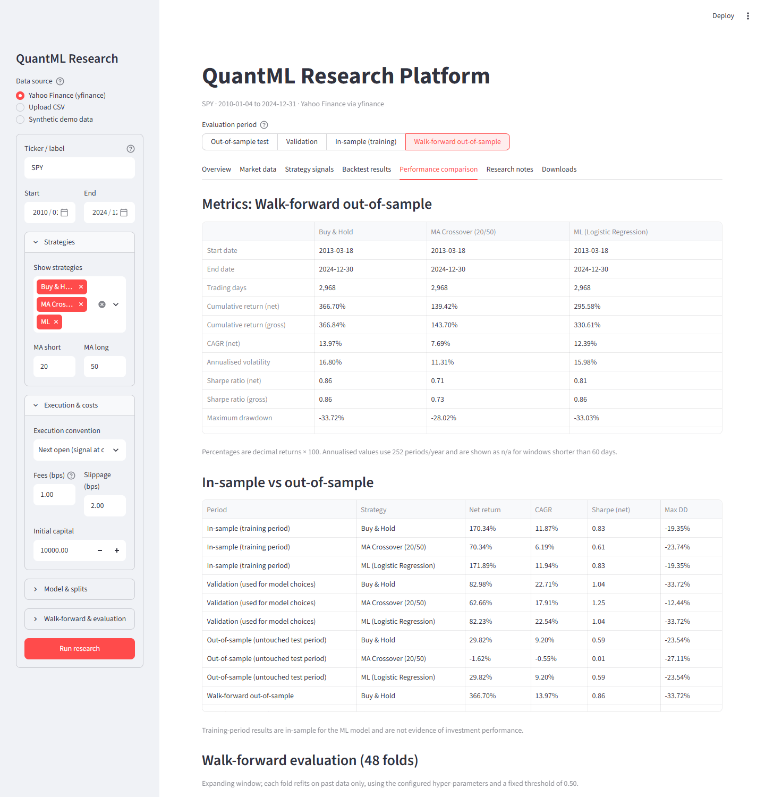

# QuantML Research Platform

[](https://github.com/DIVY3200/QuantML-Research/actions/workflows/tests.yml)

[](LICENSE)

A reproducible Python platform for asking one question honestly:

> **Does a machine-learning model provide a measurable improvement over simple benchmark
> strategies after realistic trading costs, when evaluated on unseen historical data?**

It compares three long/cash strategies on daily equity data under one execution convention and
one cost model:

| Strategy | Rule |
|---|---|
| **Buy & Hold** | Passive benchmark: fully long from the first executable point of the window. |
| **Moving-average crossover** | Long when SMA(short) > SMA(long) of the adjusted close, otherwise cash (default 20/50). |
| **ML strategy** | Logistic Regression on lagged price/volume features; long when P(next return > 0) ≥ threshold, otherwise cash. Random Forest is available as an experimental alternative. |

The emphasis is on **correct data alignment, leakage prevention, execution timing and
cost-aware evaluation**, not on producing high backtest returns.

**Finding so far:** across six instruments (SPY, AAPL, MSFT, RELIANCE.NS, TCS.NS, HDFCBANK.NS;
2010-2024, walk-forward 2013-2024), the ML strategy's net Sharpe ratio was below buy-and-hold for
five and level for one, its accuracy was below the "always predict up" baseline for all six, and
every bootstrap interval for the Sharpe difference included zero. See [Results](#results).



---

## Key features

- **Data pipeline:** Yahoo Finance download via `yfinance` with local caching, flexible CSV import
  (column-name aliases, thousands separators, timezone handling) and a clearly labelled
  synthetic generator for offline use and tests.
- **Data validation** that reports rather than repairs: duplicate/unparseable dates, missing or
  non-numeric prices, non-positive prices, OHLC inconsistencies, missing volume, insufficient
  history, unusual calendar gaps and suspicious jumps (possible unadjusted splits).
- **Leakage safeguards:** backward-looking features only, an automated look-ahead audit
  (features recomputed on truncated history must not change), purged chronological splits,
  preprocessing inside scikit-learn pipelines fitted on training rows only, and runtime
  assertions that no training label uses prices from a later period.
- **Chronological train / validation / test** split (60/20/20 by default) with hyper-parameter
  and threshold selection on validation only, plus **walk-forward** evaluation (expanding or
  rolling window).
- **Transparent backtester:** explicit signal date vs execution date, overnight/intraday return
  decomposition for next-open fills, turnover-based fees and slippage, gross and net equity,
  drawdowns and a trade log.
- **Metrics:** cumulative return, CAGR, volatility, Sharpe (with a configurable risk-free rate),
  max drawdown, Calmar, win rates, trades, turnover, exposure and cost drag. Undefined values are
  reported as missing, never as infinity.
- **Diagnostics:** accuracy vs majority-class baseline, precision/recall/F1, ROC-AUC (only when
  both classes are present), confusion matrix, probability distributions, cost-sensitivity
  curves, per-fold walk-forward results and moving-block-bootstrap Sharpe intervals.
- **Streamlit dashboard** with interactive Plotly charts and CSV downloads, all computed live.
- **Reproducible runs:** each run saves the resolved config, package versions, data provenance
  (source, retrieval time, cache use, adjustment method) and all result tables.
- **Multi-instrument study:** one command runs the identical configuration on several US and
  Indian (NSE) instruments and writes a comparison table.
- **76 automated tests** (pytest), none of which need an internet connection, run by GitHub
  Actions on Ubuntu and Windows.

---

## Architecture

```
app.py                      Streamlit dashboard (UI only; calls the package)
scripts/run_experiment.py   Command-line experiment runner -> reports/run_<timestamp>_<ticker>/
scripts/run_multi_ticker.py Same experiment on several instruments -> results/
scripts/make_sample_data.py Writes the SYNTHETIC sample CSV
config/default_config.yaml  All defaults (data, features, target, splits, model, costs, evaluation)
results/                    Committed multi-instrument results (compact summary tables)
docs/images/                Dashboard screenshots
.github/workflows/          CI: runs the test suite on every push
src/quantml/
  config.py           Typed dataclass config, YAML loading, validation, environment capture
  data_loader.py      yfinance (+cache), CSV, synthetic; column standardisation; price adjustment
  data_validation.py  Data-quality checks -> ValidationReport (errors / warnings / info)
  eda.py              Return statistics, rolling stats, Ljung-Box / Jarque-Bera tests
  features.py         Feature engineering + look-ahead audit
  labels.py           Forward-return targets aligned to the decision time
  splits.py           Purged chronological split, walk-forward folds, overlap assertions
  models.py           Model factory (scaler + logistic regression / random forest pipelines)
  strategies.py       Strategy interface: BuyAndHold, MovingAverageCrossover, ProbabilityThreshold
  backtester.py       Long/cash execution engine, costs, equity, trade log
  metrics.py          Performance and classification metrics
  evaluation.py       Validation tuning, threshold selection, cost sensitivity, block bootstrap
  pipeline.py         End-to-end orchestration -> ResearchResult
  reporting.py        Tidy export tables and saved run folders
  visualization.py    Plotly figure builders (fixed colour per strategy, light/dark palettes)
tests/                pytest suite (synthetic fixtures, no network)
notebooks/exploratory_analysis.ipynb   Guided EDA + pipeline walkthrough (with stored outputs)
```

Data flow: **load → validate → prepare (adjust once) → features & labels → purged split →
tune on validation → fit on train → signals → backtests on identical windows → walk-forward →
diagnostics → report**.

---

## Installation

Requires Python 3.10+ (developed with **Python 3.13.7** on Windows 11; CI runs Python 3.11 and
3.13 on Ubuntu and 3.13 on Windows).

```bash
git clone https://github.com/DIVY3200/QuantML-Research.git
cd QuantML-Research
```

```powershell
# Windows (PowerShell)
py -3.13 -m venv .venv
.\.venv\Scripts\python.exe -m pip install --upgrade pip
.\.venv\Scripts\python.exe -m pip install -r requirements.txt
.\.venv\Scripts\python.exe -m pip install -e . --no-deps   # optional: importable package
```

```bash
# macOS / Linux
python3 -m venv .venv
source .venv/bin/activate
pip install -r requirements.txt
pip install -e . --no-deps
```

Versions verified in the development environment: numpy 2.5.4, pandas 2.3.3, scipy 1.18.1,
scikit-learn 1.9.1, statsmodels 0.15.0, yfinance 1.7.0, plotly 7.1.0, streamlit 1.66.0,
pytest 9.1.1. No API keys or environment variables are needed. To re-execute the notebook with
stored outputs, also install `requirements-dev.txt` (Jupyter kernel, nbclient, kaleido).

---

## Running

### Dashboard

```bash
streamlit run app.py          # Windows: .\.venv\Scripts\streamlit.exe run app.py
```

Choose a data source in the sidebar (Yahoo Finance, CSV upload or synthetic), adjust settings,
and press **Run research**. A segmented control above the tabs selects the evaluation period
(out-of-sample test, validation, in-sample, walk-forward) for the signal, backtest and
performance views.

| Tab | Contents |
|---|---|
| Overview | Instrument, observations, data-quality status, key assumptions, warnings, headline test metrics |
| Market data | Price, volume, daily returns, return distribution, rolling mean/volatility, drawdown, feature correlations, statistical tests |
| Strategy signals | Price with signal-generation markers *and* execution markers, moving averages, ML probability series with split bands and threshold, trade log |
| Backtest results | Net (and optional gross) equity curves, drawdowns, cumulative costs, gross vs net table, position/exposure panels |
| Performance comparison | Side-by-side metrics, in-sample vs out-of-sample, walk-forward folds, classification diagnostics, cost sensitivity, bootstrap intervals, model selection details |
| Research notes | Feature definitions, split configuration, strategy rules, cost assumptions, integrity checks, data provenance, limitations, full config and package versions |
| Downloads | CSVs of daily equity/returns/positions/costs, predictions, metrics, trades, walk-forward folds, cost sensitivity, config; "save run to reports/" |

| Overview | Signals: generation vs execution |
|---|---|
|  |  |

| Performance comparison |
|---|
|  |

### Command line

```bash
python scripts/run_experiment.py                                   # SPY 2010-2024 via yfinance
python scripts/run_experiment.py --source synthetic                # offline, SYNTHETIC data
python scripts/run_experiment.py --ticker RELIANCE.NS --start 2012-01-01 --end 2024-12-31
python scripts/run_experiment.py --csv data/sample/SYNTHETIC_sample_ohlcv.csv
python scripts/run_experiment.py --model random_forest --execution next_close --threshold-selection validation
```

Each run prints the metric tables and writes `reports/run_<UTC timestamp>_<ticker>/` containing
`config.yaml`, `run_info.json` (package versions, data provenance, checks), `metrics.csv`,
`classification_metrics.csv`, `daily_results.csv`, `predictions.csv`, `trades_test.csv`,
`walk_forward_*.csv`, `cost_sensitivity.csv`, `bootstrap_*.csv` and `summary.md`.

### Tests

```bash
python -m pytest              # 76 tests, ~20 s, no network required
```

### Multi-instrument study

```bash
python scripts/run_multi_ticker.py                       # SPY AAPL MSFT RELIANCE.NS TCS.NS HDFCBANK.NS
python scripts/run_multi_ticker.py --tickers SPY INFY.NS --out results_custom
```

---

## Data

### Downloading historical data

The default instrument is **SPY** (a liquid US ETF). Any Yahoo Finance symbol can be used, e.g.
`AAPL`, `MSFT`, or Indian listings such as `RELIANCE.NS` / `HDFCBANK.NS` (NSE) or `.BO` (BSE).
Provider coverage, symbol conventions and the length of available history vary by market.

- The end date is **inclusive** (the loader passes `end + 1 day` to yfinance, whose end is exclusive).
- Completed ranges are cached in `data/raw/<TICKER>_<start>_<end>_1d.csv` with a `.meta.json`
  recording the retrieval time and yfinance version. Delete the file to force a re-download.
  Ranges reaching today are not cached because the latest bar can still change.
- Yahoo Finance data is free but unofficial: it can contain errors, be revised, or change its
  adjustment history, and its terms restrict redistribution. Re-downloading can change results.

### Loading CSV data

Upload in the dashboard or pass `--csv`. Required columns: **Date, Open, High, Low, Close**;
optional **Adj Close** and **Volume**. Names are matched case-insensitively with common aliases
(`Trade Date`, `Adj_Close`, `Adjusted Close`, `Shares Traded`, ...). Dates may be ISO strings or
timezone-aware timestamps (converted to the local trading date). Thousands separators are
accepted. The dashboard's start/end dates are applied to CSV data.

### Price adjustments (splits and dividends)

Yahoo's `Close` is split-adjusted but **not** dividend-adjusted; `Adj Close` reflects both. The
loader downloads with `auto_adjust=False` and builds adjusted Open/High/Low/Close by multiplying
the raw columns by `Adj Close / Close`, **once**, so returns include dividends and intraday
ratios are preserved. It never combines `auto_adjust=True` with a second adjustment. If a CSV
has no adjusted close, prices are used as given (returns then exclude dividends) and a warning
is shown; very large one-day moves are flagged as possible unadjusted splits.

### Synthetic data

`data/sample/SYNTHETIC_sample_ohlcv.csv` and the "Synthetic demo data" option are generated noise
(GARCH-style volatility, no built-in predictability). They exist for tests and offline demos,
are labelled SYNTHETIC everywhere they appear, and must never be presented as market results.
Missing observations in real data are never filled with invented values.

---

## Methodology

### Features (all known at the close of day *t*)

| Feature | Definition |
|---|---|
| `ret_lag_0..4` | Close-to-close returns ending at t, t-1, ..., t-4 |
| `mom_5/10/20` | close[t] / close[t-w] - 1 |
| `vol_10/20` | Standard deviation of the last w daily returns |
| `dist_ma_10/20/50` | close / SMA(w) - 1 |
| `ma_ratio_5_20`, `ma_ratio_20_50` | SMA(s) / SMA(l) - 1 |
| `hl_range` | (high - low) / close |
| `range_pos_20` | Position of the close in the 20-day high-low range |
| `volume_ratio_20` | volume / SMA20(volume) - 1 (only when volume data is usable) |
| `volume_change_1d` | log(1 + V[t]) - log(1 + V[t-1]) |

All windows are configurable. Rows inside the longest lookback are dropped, not filled.
`audit_lookahead` recomputes the features on history truncated at sampled dates and fails if any
value changes; it runs in every experiment and in the tests (including a test proving it catches
a deliberately leaky feature).

### Target

For a feature row dated *t* the default label is `1` if `close[t+1] / close[t] - 1 > 0`, else
`0`: the return **after** the decision time, never one that already happened. The horizon and
threshold are configurable, and `target.basis: execution` aligns the label with the fill
convention (e.g. `open[t+2] / open[t+1] - 1` for next-open execution). The last rows without a
complete forward window are excluded from training and classification metrics.

### Train / validation / test and walk-forward

- Eligible rows (complete features and label) are split chronologically, 60/20/20 by default.
- At each boundary the last `horizon` (+ `embargo`) rows are **purged** so no training label
  depends on a price inside the next period; this is also asserted at run time.
- Hyper-parameters (logistic `C`, forest depth) are chosen by **validation log loss**; the
  optional threshold search maximises **validation** net Sharpe. The test period is never used
  for any choice. Results are reported separately as *in-sample*, *validation* and
  *out-of-sample*.
- **Walk-forward:** train on all past data (or a rolling window), predict the next block
  (default 63 days), roll forward, refit, and stitch the out-of-sample predictions together.
  Walk-forward deliberately uses the *configured* hyper-parameters and threshold, because values
  tuned on the holdout validation period would leak information into earlier folds.

### Backtesting assumptions

**Execution convention (same for every strategy):** a target position is computed after the
close of day *t* from data up to *t*, and executed at the next trading observation:

- `next_open` (default): filled at `open[t+1]`. On day *t+1* the new position earns only the
  intraday move open → close; the overnight gap close[t] → open[t+1] belongs to the position held
  before the trade. Daily gross return:
  `(1 + position[t-1] * overnight[t]) * (1 + position[t] * intraday[t]) - 1`.
- `next_close`: filled at `close[t+1]`; the new position first earns day *t+2*.
  `gross[t] = position[t-1] * (close[t] / close[t-1] - 1)`.

So `position[t] = signal[t-1]`. Every evaluation window starts in cash, the signal generated on
the final day is never executed, and open positions are marked to market at the final close (no
artificial extra period). Positions are restricted to `[0, 1]`: no leverage, shorting or margin.
Missing signals mean cash.

### Transaction costs and slippage

`turnover[t] = |position[t] - position[t-1]|` (entering or exiting a full position = 1.0).
`cost[t] = turnover[t] × (fee_bps + slippage_bps) / 10,000`, charged as a fraction of equity on
the execution day; `net[t] = gross[t] - cost[t]`. Defaults: 1 bp fees + 2 bp slippage per unit
of turnover, i.e. 3 bp per entry or exit. Setting both to 0 gives a gross diagnostic run; the
cost-sensitivity analysis re-runs fixed signals across 0-50 bp. These are generic assumptions,
not quotes for any broker, exchange or instrument.

### Metrics

Returns are decimals internally (0.01 = 1%) and percentages on screen. Annualisation uses 252
periods per year (a convention; actual trading days vary by year and exchange). The annual
risk-free rate is converted geometrically to a daily rate for the Sharpe ratio. Cash earns 0% in
the backtest, so a positive risk-free rate penalises time in cash. Sharpe, CAGR and other
annualised values are reported as `n/a` for windows shorter than 60 days, when volatility is
zero, or when the ratio is otherwise undefined (e.g. Calmar with no drawdown).

**Why accuracy is not profitability:** a classifier can be right on many small moves and wrong on
a few large ones, its predictions may be concentrated in low-volatility periods, and trading
on them incurs costs. The dashboard therefore compares accuracy with the majority-class baseline
and always reports cost-inclusive strategy returns alongside classification metrics.

**Bootstrap:** a moving-block bootstrap (20-day blocks, 1,000 resamples, same blocks for every
strategy) gives approximate intervals for each Sharpe ratio and for the difference from Buy &
Hold. It assumes rough stationarity within the window, does not correct for the number of
configurations tried, and is not presented as a formal significance test.

---

## Results

Recorded runs, not performance claims. Default configuration for every instrument: daily data
2010-01-01 to 2024-12-31 from Yahoo Finance, next-open execution, 3 bp per unit turnover,
logistic regression, walk-forward folds of 63 trading days with an expanding window. Outputs:
[`results/`](results/) (per-instrument tables, configuration, package versions and data
provenance).

### Six instruments, walk-forward out-of-sample (2013-2024)

| Instrument | Net Sharpe: Buy & Hold | MA 20/50 | ML | ML gross Sharpe | ML position changes | ML accuracy (baseline) | ML - B&H Sharpe, 95% CI | Folds ML > B&H |
|---|---|---|---|---|---|---|---|---|
| SPY | 0.86 | 0.71 | 0.81 | 0.86 | 283 | 54.5% (55.1%) | [-0.22, +0.12] | 12 / 48 |
| AAPL | 1.02 | 0.75 | 1.03 | 1.11 | 661 | 51.1% (53.2%) | [-0.37, +0.35] | 19 / 48 |
| MSFT | 1.07 | 0.69 | 0.86 | 0.99 | 987 | 51.0% (53.3%) | [-0.55, +0.11] | 21 / 48 |
| RELIANCE.NS | 0.77 | 0.33 | 0.49 | 0.59 | 780 | 50.5% (51.8%) | [-0.70, +0.17] | 20 / 46 |
| TCS.NS | 0.82 | 0.17 | 0.64 | 0.70 | 497 | 50.6% (51.7%) | [-0.53, +0.13] | 20 / 46 |
| HDFCBANK.NS | 0.81 | 0.65 | 0.63 | 0.74 | 793 | 50.6% (51.7%) | [-0.51, +0.16] | 19 / 46 |

- The ML strategy's net Sharpe was below buy-and-hold for five instruments and level for AAPL
  (1.03 vs 1.02, with a much lower total return: 1,056% vs 1,695%).
- Before costs the ML strategy was ahead on AAPL (gross Sharpe 1.11); turnover of several hundred
  position changes removed that gap.
- Accuracy was below the majority-class ("always up") baseline for all six instruments.
- **Why one test window is not enough:** in the single holdout test period (2022-01-11 to
  2024-12-31) the ML strategy beat buy-and-hold on all three NSE stocks (e.g. RELIANCE.NS net
  Sharpe 0.61 vs 0.19), yet over 46 walk-forward folds it trailed on all three.
- NIFTYBEES.NS was excluded because validation found prices at one-tenth scale on two days in
  December 2019 (see [`results/README.md`](results/README.md)).

### SPY in detail

SPY retrieved 2026-10-20. Full outputs: [`results/SPY/`](results/SPY/).

| Period | Strategy | Net return | Net Sharpe | Max drawdown | Position changes |
|---|---|---|---|---|---|
| Test 2022-01-11 to 2024-12-31 | Buy & Hold | 29.82% | 0.59 | -23.54% | 1 |
| | MA Crossover (20/50) | -1.62% | 0.01 | -27.11% | 17 |
| | ML (Logistic Regression) | 29.82% | 0.59 | -23.54% | 1 |
| Walk-forward 2013-03-18 to 2024-12-30 (48 folds) | Buy & Hold | 366.70% | 0.86 | -33.72% | 1 |
| | MA Crossover (20/50) | 139.42% | 0.71 | -28.02% | 59 |
| | ML (Logistic Regression) | 295.58% | 0.81 | -33.03% | 283 |

What this run shows:

- In the holdout test period the validation-selected model (strongly regularised, `C = 0.001`)
  predicted "up" on every day, so it was identical to Buy & Hold. Its accuracy equalled the
  base rate (52.9%) and its ROC-AUC was 0.49.
- In walk-forward evaluation the ML strategy's gross Sharpe (0.86) matched Buy & Hold, but 283
  position changes cost about 8.5% of equity in total, leaving a lower net Sharpe (0.81). It
  outperformed Buy & Hold in 12 of 48 folds. The bootstrap 95% interval for the net Sharpe
  difference versus Buy & Hold was [-0.22, +0.12].
- Walk-forward accuracy was 54.5% against a 55.1% majority-class baseline (ROC-AUC 0.50).

**Conclusion for this configuration: no evidence that the ML model improves on Buy & Hold after
costs, on any of the six instruments tested.** That is a legitimate research result. Other
horizons, features or markets may behave differently, and re-downloading data may change the
numbers.

---

## Research Integrity and Limitations

- **Historical performance does not guarantee future results.** Market regimes change.
- **Free data can be incomplete or revised.** Yahoo Finance adjustments and history can change
  between downloads; the run records the retrieval time, but the provider's data is not frozen.
- **Survivorship bias, corporate actions and data quality.** Choosing an instrument that exists
  today biases the sample; corporate-action adjustments can be wrong; validation flags but cannot
  fix bad data.
- **Multiple testing and selection bias.** Every additional configuration you try is another
  test. The best of many runs is optimistically biased; bootstrap intervals do not adjust for this.
- **One instrument is not enough** to establish that a strategy is robust.
- **Simplified execution and costs.** Fills at the official open/close with a fixed cost ignore
  spreads that vary over time, market impact, auction dynamics, taxes, borrow constraints and
  latency.
- **Research and education only.** This is not financial advice and not an automated or live
  trading system.

### Reproducibility

A fixed random seed is **not** sufficient. A run is reproducible only with the same data, the same
configuration and compatible package versions. Each saved run records all three. Because the
online data source can change, keep the cached CSV in `data/raw/` (or export your own CSV) if you
need to reproduce a result exactly.

---

## Troubleshooting

| Problem | What to do |
|---|---|
| `No data returned for 'XYZ'` | Check the symbol and suffix (`.NS`, `.BO`, `.L`, ...), the date range and your connection; or upload a CSV / use synthetic data. |
| Download errors or rate limiting | Retry later, rely on the cache in `data/raw/`, or upload a CSV. |
| `Data validation failed` | Read the listed issues (duplicates, missing or non-positive prices, OHLC errors, too few rows) and fix the source file; missing prices are never filled automatically. |
| `Only N usable daily observations` | Use a longer date range, or lower `validation.min_observations` for exploration. |
| `Training set has N rows` / `Test set has N rows` | Increase the date range or adjust split proportions. |
| Walk-forward skipped | `walk_forward.initial_train_size` is larger than the eligible history; reduce it. |
| `Training labels contain only one class` | The training window is too short or the target threshold too extreme. |
| Sharpe / CAGR shown as `n/a` | The window is shorter than 60 days, volatility is zero (e.g. a strategy that stayed in cash), or the ratio is undefined. |
| Two equity curves coincide | The strategies held identical positions (the dashboard says so explicitly). |
| `streamlit` not found | Activate the virtual environment or call `.venv\Scripts\streamlit.exe run app.py`. |

---

## Known limitations

- Long/cash only; one instrument at a time; daily bars only.
- Costs are proportional to turnover; there is no spread model, market-impact model or minimum
  commission. Cash earns no interest.
- The bootstrap is approximate (block length fixed by configuration; no multiple-testing
  correction).
- The study covers six instruments and one 2010-2024 period, which is still a small sample.
- The notebook's stored outputs come from one execution; re-running it needs
  `requirements-dev.txt` and a local Chrome/Chromium for static chart export.

## Future improvements

- Multi-asset portfolios and cross-sectional features; cash earning the risk-free rate.
- Spread- and volatility-dependent cost models; volume-participation limits.
- Purged k-fold / combinatorial purged cross-validation and the deflated Sharpe ratio to account
  for multiple testing.
- Probability calibration analysis and position sizing from predicted probabilities.
- Additional model families evaluated under the same protocol (gradient boosting, regularised
  linear models with interaction terms).
